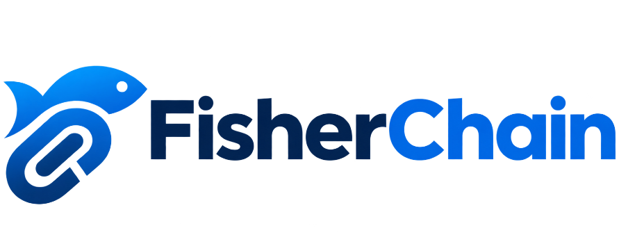

# FisherChain Enterprise Seafood Traceability Protocol

<p align="center">
  
</p>

<p align="center">
  <strong>Decentralized Chain-of-Custody Infrastructure for Global Commercial Fisheries</strong><br>
  <em>Eliminating seafood fraud, catch mislabeling, and opaque pricing from ocean harvest to consumer checkout.</em>
</p>

<p align="center">
  <a href="https://soliditylang.org/"></a>
  <a href="https://hardhat.org/"></a>
  <a href="https://react.dev/"></a>
  <a href="https://docs.ethers.org/v6/"></a>
  <a href="https://traceability-dialogue.org/"></a>
  <a href="LICENSE"></a>
</p>

---

## Executive Summary

The global seafood supply chain suffers from severe structural vulnerabilities caused by reliance on paper manifests, fragmented databases, and untrusted intermediaries:

* **~20% Global Mislabeling Rate:** Studies by Oceana, WWF, and maritime researchers confirm that nearly 1 in 5 seafood samples worldwide are fraudulently mislabeled—farmed fish substituted for wild-caught, and low-cost fish disguised as premium species.
* **Opaque Harbour Pricing:** Coastal fishing vessel captains often receive minimal compensation, while layers of intermediary brokers inflate prices 3–4× with zero visibility back to the harvest origin.
* **Protracted Contamination Recalls:** Foodborne illness outbreaks require weeks to trace upstream through paper manifests, making localized batch isolation nearly impossible.
* **Illegal, Unreported, and Unregulated (IUU) Fishing:** Banned catches and overfished stocks easily infiltrate legitimate retail channels due to lack of tamper-proof audit trails.

**FisherChain** solves these challenges by anchoring the seafood supply chain to an immutable, decentralized ledger. Every catch event, custody handoff, GPS coordinate, and commercial transaction price is cryptographically sealed onto an open Ethereum smart contract, creating a permanent passport that can be verified in real time by processors, distributors, retailers, and end consumers.

---

## High-Level Architecture & Data Flow

```
   [ Fishing Vessel ]              [ Harbor Port ]             [ Cold Logistics ]          [ Supermarket / Retail ]          [ End Consumer ]
  Captures wild catch             Auction & first sale         Refrigerated transit         GS1 Barcode / QR Label         Zero-Login Verification
          │                              │                             │                             │                             │
          ▼                              ▼                             ▼                             ▼                             ▼
 ┌──────────────────┐          ┌───────────────────┐         ┌────────────────────┐        ┌─────────────────────┐       ┌────────────────────┐
 │  registerCatch() │          │  transferBatch()  │         │  transferBatch()   │        │   transferBatch()   │       │   getBatchHistory()│
 │  Stage: Caught   ├─────────►│  Stage: Auctioned ├────────►│  Stage: InTransit  ├───────►│  Stage: AtRetailer  ├──────►│  Stage: Sold      │
 └────────┬─────────┘          └─────────┬─────────┘         └─────────┬──────────┘        └──────────┬──────────┘       └─────────┬──────────┘
          │                              │                             │                              │                            │
          └──────────────────────────────┴─────────────────────────────┴──────────────────────────────┴────────────────────────────┘
                                                                       │
                                                       Ethereum Virtual Machine (EVM)
                                                    Immutable Monotonic State Machine
                                                                       │
                                              ┌────────────────────────┴────────────────────────┐
                                              ▼                                                 ▼
                                     [ IPFS Pinata Gateway ]                         [ Automated Audit Engine ]
                              Harvest photos, certificates, hashes             Chronological checks & price anomaly guard
```

---

## Core Capabilities & Supply Chain Modules

| Module | Target Actor | Key Features |
|---|---|---|
| **Harbor Catch Registry** | Fishing Captains | GPS location capture, FAO maritime zone classification, species catalog, landing weight, initial vessel price, IPFS catch certification. |
| **Logistics & Custody** | Auctioneers & Transporters | Monotonic stage handoff validation, custody recipient address enforcement, cold-chain handover documentation. |
| **Retail Storefront Portal** | Fishmongers & Supermarkets | Reception timestamping, inventory management, GS1-compliant QR code sticker generation for consumer packaging. |
| **Consumer Trace Portal** | End Shoppers | Zero-login public search, instant timeline reconstruction, species verification badge, and direct smart contract explorer link. |
| **Governance & Role Control** | Port Authorities / Admin | Cryptographic role authorization (`registerFisherman`), anomaly flags, and multi-contract administrative parameters. |
| **Automated Audit Engine** | Regulators & Compliance | Algorithmic chronological sequence validation and price anomaly alerts (detecting >300% markup spikes between hops). |

---

## Smart Contract Specification (`FisherChain.sol`)

The core business logic is implemented in Solidity `^0.8.19` and compiled with the Hardhat framework.

### Data Structures

```solidity
enum Stage { Caught, Auctioned, InTransit, AtRetailer, SoldToConsumer }

struct Batch {
    uint256 batchId;
    address fisherman;
    string species;
    uint256 quantity;       // Harvest weight in kilograms (kg)
    string catchLocation;   // GPS coordinates string (e.g., "12.9716 N, 77.5946 E")
    uint256 catchTimestamp; // Unix epoch timestamp
    string ipfsHash;        // Pinata IPFS multihash for catch photograph / lab certificate
    uint256 currentPrice;   // Price in Wei or localized currency units
    address currentOwner;   // Current cryptographic custodian
    Stage currentStage;      // Forward-only state machine stage
}

struct Transfer {
    address from;
    address to;
    uint256 price;
    uint256 timestamp;
    Stage stageAtTransfer;
}
```

### Invariants & Access Control

1. **Monotonic Forward Progression:** `require(uint8(_newStage) > uint8(batch.currentStage))` prevents any party from rolling back state or re-registering an already processed catch.
2. **Current Custodian Authorization:** `require(batch.currentOwner == msg.sender)` enforces that only the legal holder of custody can hand off the batch to a subsequent recipient.
3. **Authorized Fishermen Gateway:** `registerCatch()` is protected by the `onlyRegisteredFisherman` modifier, ensuring that unvetted actors cannot inject counterfeit catch data.
4. **Complete Transfer Audit Trail:** Every `transferBatch()` execution records a permanent `Transfer` struct into the on-chain `batchHistory` mapping and emits the `BatchTransferred` event.

---

## Enterprise Technology Stack

* **Blockchain & Smart Contracts:**
  * Solidity `^0.8.19` (Object-oriented high-level language for EVM smart contracts)
  * Hardhat `2.22.x` (Local node orchestration, automated testing, task runners)
  * Ethers.js `v6.x` (Modern asynchronous contract provider and signer interface)
* **Decentralized Storage:**
  * IPFS via Pinata Dedicated Gateway (Off-chain storage for high-resolution harvest photos and health inspection PDFs)
* **Frontend Application:**
  * React 18 (Component architecture with Hooks and Context API)
  * Enterprise Clean Design System: White (`#ffffff`), Light Blue (`#eff6ff`, `#0284c7`), Slate Navy (`#0f172a`)
  * Standard 24x24 SVG Iconography (Custom-engineered vector icons; no third-party bundle bloat)
  * Interactive Brand Hero: Live on-chain passport card, species catalog, and interactive 5-stage workflow
  * Intro Animation Loader: Elastic logo drop, left/right chain interlocking animation, and staggered typography reveal
* **Off-Chain Identity Layer (Optional):**
  * Node.js + Express REST API
  * MongoDB + Mongoose (Enterprise profile sync, vessel port registration, and contact information)

---

## Automated Verification & Test Suite

The smart contract test suite includes **7 comprehensive unit test suites** executed via Mocha and Chai:

```bash
npx hardhat test
```

```text
  FisherChain
    ✔ should set the deployer as admin
    ✔ should allow admin to register a fisherman
    ✔ should allow a registered fisherman to register a catch
    ✔ should NOT allow an unregistered address to register a catch
    ✔ should allow transferring a batch to the next stage
    ✔ should NOT allow a non-owner to transfer the batch
    ✔ should track batch history correctly

  7 passing (2s)
```

The frontend client test suite verifies navigation integrity, wallet connection bindings, and brand presentation:

```bash
cd client
npm test -- --watchAll=false
```

```text
PASS src/App.test.js
  ✓ renders FisherChain official navbar, brand and overview

Test Suites: 1 passed, 1 total
Tests:       1 passed, 1 total
```

---

## Developer Quickstart Guide

### Prerequisites
* **Node.js:** `v18.x` or `v20.x` LTS
* **Package Manager:** `npm` (included with Node.js)
* **Web3 Wallet:** MetaMask browser extension

### 1. Repository Setup

```bash
git clone https://github.com/anoopcodehack/fisherchain.git
cd fisherchain

# Install root smart contract dependencies
npm install

# Install frontend dependencies
cd client
npm install
cd ..
```

### 2. Launch Local Blockchain Node

Start a standalone Hardhat node simulating an EVM environment with 20 pre-funded test accounts:

```bash
npx hardhat node
```
*RPC URL:* `http://127.0.0.1:8545`  
*Network Name:* Hardhat Local  
*Chain ID:* `31337`

### 3. Deploy Smart Contract

In a new terminal window, deploy `FisherChain.sol` to the local node:

```bash
npx hardhat ignition deploy ignition/modules/FisherChain.js --network localhost
```

The deployment script writes the contract address to `client/src/utils/contract.js` automatically (default: `0x5FbDB2315678afecb367f032d93F642f64180aa3`).

### 4. Launch the Frontend Application

```bash
cd client
npm start
```

Access the enterprise portal at **`http://localhost:3000`**.

### 5. MetaMask Configuration for Local Testing

1. Open MetaMask $\rightarrow$ Select Network Dropdown $\rightarrow$ **Add Network Manually**.
2. **Network Name:** Hardhat Local
3. **New RPC URL:** `http://127.0.0.1:8545`
4. **Chain ID:** `31337`
5. **Currency Symbol:** `ETH`
6. Import Account #0 (Deployer / Admin) or Account #1 using the private keys output in the `npx hardhat node` terminal.

---

## Compliance & Standards Alignment

* **GDST 1.2 (Global Dialogue on Seafood Traceability):** Implements Key Data Elements (KDEs) including harvest location (latitude/longitude), vessel identity, landing date, scientific species naming (*FAO ASFIS*), and chain-of-custody tracking.
* **MSC Chain of Custody Standard:** Provides cryptographic assurance that certified seafood is segregated and identifiable throughout processing and transit.
* **GS1 Digital Link Compatibility:** The QR generator module exports GS1 standard URLs encoding batch identifiers for high-speed retail barcode scanners.

---

## Production Roadmap & Enterprise Pilots

- [x] EVM Smart Contract with forward-only monotonic state machine
- [x] Role-Based Access Control (Admin, Fisherman, Logistics, Retailer, Consumer)
- [x] Zero-Login Public Batch Trace Portal with GS1 QR Code Exporter
- [x] Automated Audit Engine (Chronology integrity and price markup anomaly detection)
- [x] Commercial-grade UI with official FisherChain branding and interactive loader
- [ ] Sepolia Testnet deployment with verified Etherscan contract source
- [ ] IoT Bluetooth / LoRa cold-chain temperature logger integration
- [ ] Multi-sig governance for accredited maritime regulatory bodies (MSC, NOAA, EU CFP)

---

## License

This project is licensed under the **MIT License** — see the [LICENSE](LICENSE) file for details.

```text
Copyright (c) 2026 FisherChain Systems Inc.
```
